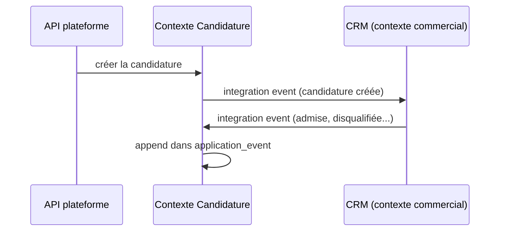

Dans la plateforme sur laquelle je travaille, la **candidature** est une entité centrale. Son statut a un impact sur beaucoup de choses : la qualification d'un user en talent, le démarrage d'un parcours, un changement de parcours. Elle est lue partout.

Et pendant longtemps, chaque lecture coûtait cher. Pour obtenir une candidature, le code devait **reparcourir tous ses événements**, en espérant qu'il n'en manque aucun.

Cet article revient sur ce design, sur ce que c'est réellement (spoiler : de l'event sourcing, même si on ne l'avait pas appelé comme ça), et sur la solution mise en place : un **snapshot compilé à l'écriture**.

---

## Le design de départ

Deux tables :

- `application` : `id`, `created_at`. Quasiment rien d'autre.
- `application_event` : tous les événements liés à chaque candidature.

La candidature est créée côté plateforme via l'API. Un **integration event** est alors envoyé au **CRM** de l'équipe commerciale, qui est un autre Bounded Context. La candidature évolue ensuite dans le CRM (qualification, admission, disqualification...), et le CRM renvoie des integration events vers la plateforme.



Pour connaître l'état courant d'une candidature, un service charge tous ses événements dans l'ordre et les applique un par un via des *processors* :

```php
foreach ($events as $event) {
    foreach ($this->processors as $processor) {
        if ($processor->supports($event)) {
            $processor->apply($event, $application);
        }
    }
}
```

Fonctionnellement, ça marche. Mais comme la candidature est lue un peu partout, ce rejeu complet se retrouvait dans énormément de chemins de code. Avec un coût qui grandit avec l'historique de chaque candidature.

---

## Est-ce de l'event sourcing ?

Ma première réaction a été de dire non : aucun outil d'event sourcing, aucun event store dédié, on stocke juste les événements dans une table.

En fait, si. L'event sourcing ne demande pas de framework. Il suffit que **l'état soit dérivé d'un journal d'événements append-only**. C'est exactement ce qu'on faisait.

Par contre, c'était un event sourcing **involontaire**, avec quelques ingrédients manquants :

- **Des commandes plutôt que des faits.** Les événements étaient nommés et construits à partir des requêtes des use cases (`AdmitApplicationEvent`), pas comme des faits passés du langage métier (`ApplicationAdmitted`). On stocke ce qu'on a demandé, pas ce qui s'est passé.
- **Pas de règles dans l'aggregate.** Les processors appellent des setters, l'entité ne décide rien. Toute la logique est dans des services.
- **Pas de concurrence optimiste.** Aucun numéro de version par candidature, donc rien n'empêche deux écritures concurrentes de s'entrelacer.
- **Pas de snapshot.** D'où le rejeu complet à chaque lecture.

Le dernier point, c'est celui qui faisait mal en prod.

---

## La solution : compiler l'état à l'écriture

L'idée est simple. Au lieu de recalculer l'état à chaque lecture, on le recalcule **à chaque nouvel événement**, et on le stocke.

Une colonne `JSONB` sur la table `application`, régénérée à chaque événement :

- la donnée est "compilée" à l'écriture,
- la lecture est directe.

```php
abstract class Application
{
    protected array $snapshot = [];

    public function admit(int $grantedPathId, \DateTimeImmutable $at): void
    {
        $this->stage = ApplicationStage::ADMITTED;
        $this->grantedPathId = $grantedPathId;
        $this->admittedAt = $at;

        $this->snapshot['stage'] = $this->stage->value;
        $this->snapshot['grantedPathId'] = $grantedPathId;
        $this->snapshot['admittedAt'] = $at->format(DATE_ATOM);
    }
}
```

Côté lecture, les requêtes qui avaient besoin de l'état courant tapent directement dans la colonne :

```sql
SELECT a.id, a.user_id
FROM application a
WHERE a.snapshot->>'stage' = :stage
  AND a.snapshot->>'grantedPathId' IS NOT NULL;
```

Et si besoin, un index d'expression PostgreSQL rend ces filtres aussi rapides qu'une colonne classique :

```sql
CREATE INDEX idx_application_stage ON application ((snapshot->>'stage'));
```

On garde évidemment tous les événements. Ils restent la source de vérité, et une commande permet de **reconstruire les snapshots** à partir de l'historique si on change le format ou si on corrige un processor.

---

## Snapshot, projection, CQRS : comment l'appeler ?

J'ai d'abord présenté ça comme du CQRS. C'est en partie vrai, mais le terme le plus juste est **snapshot**.

- **Snapshot** (vocabulaire event sourcing) : l'état matérialisé à un instant donné, pour éviter de rejouer tout l'historique.
- **Projection en ligne** : ce snapshot sert aussi directement aux requêtes de lecture.
- **CQRS** au sens strict, c'est un modèle d'écriture et un modèle de lecture **séparés**. Ici, c'est la même entité qui écrit les deux, dans la même transaction.

Ce n'est pas un défaut, c'est même plus simple à opérer. Le vrai CQRS commencera le jour où les lectures (recherche de talents, listes, filtres) passeront par un modèle dédié, construit pour elles.

---

## Les pièges

### 1. Le snapshot doit servir au chargement, pas seulement aux requêtes

<!-- TODO: vérifier l'état actuel du chemin de chargement avant publication -->

C'est le piège dans lequel on tombe facilement. Le snapshot est écrit, les requêtes SQL l'utilisent, mais le **chargement de l'aggregate** continue de rejouer tous les événements.

Deux conditions pour que ça ne soit pas le cas :

1. **persister le curseur** : l'id du dernier événement appliqué (ou une version). S'il n'est pas mappé, il vaut `null` au chargement et rien n'est sauté,
2. **hydrater l'entité depuis le snapshot**, puis ne rejouer que les événements postérieurs au curseur.

```php
public function get(ApplicationId $id): Application
{
    $application = $this->loadFromSnapshot($id); // état + lastEventId

    $newEvents = $this->events->findAfter($id, $application->lastEventId());
    $this->projector->apply($application, $newEvents); // normalement vide

    return $application;
}
```

Le rejeu complet devient alors un outil de reconstruction, pas le chemin nominal.

### 2. Deux sources de vérité, une seule transaction

On a maintenant l'événement **et** le snapshot. Si l'événement est flushé de son côté et le snapshot plus tard, une erreur entre les deux laisse un snapshot en retard sur l'historique.

Les deux doivent être écrits **dans la même transaction** :

```php
$this->em->wrapInTransaction(function () use ($application, $event): void {
    $this->em->persist($event);
    $this->projector->apply($application, [$event]);
    $this->em->persist($application);
});
```

Et garder la commande de reconstruction sous la main, pour les cas où ça dérape quand même.

### 3. Le snapshot devient un contrat entre contextes

Dès que le JSON est requêtable, la tentation est forte de le lire depuis ailleurs. Chez nous, le contexte Matching filtre les talents directement sur des clés du snapshot de la candidature.

Résultat : le **format interne** du contexte Candidature est devenu un **contrat implicite** pour un autre Bounded Context. Quelqu'un renomme une clé, et la recherche de talents casse sans prévenir.

Deux options :

- un **port de lecture publié** par le contexte Candidature, dont il est propriétaire,
- mieux à terme : une **projection propre au Matching**, alimentée par des événements (`ApplicationAdmitted`, `ApplicationDisqualified`). C'est d'ailleurs ce qui devrait déclencher la qualification ou la disqualification d'un talent.

### 4. Versionner le format du snapshot

Le snapshot évolue avec le modèle. Une clé ajoutée n'existe pas sur les anciennes lignes tant qu'on ne les a pas reconstruites. Soit on reconstruit systématiquement après chaque changement de format, soit on stocke une version de schéma dans le snapshot et on gère l'absence de clé à la lecture.

---

## Qui est propriétaire du cycle de vie ?

C'est la question DDD qui, au fond, justifie le mieux l'approche.

La candidature est créée chez nous, mais une grande partie de son évolution est décidée dans le CRM. Côté plateforme, elle est donc en bonne partie une **réplique locale** d'un objet dont le cycle de vie appartient à un autre contexte, plus quelques parties locales (création, étapes du formulaire).

Pour une donnée qui vient d'ailleurs, une **projection matérialisée** est exactement le bon outil. Les invariants métier les plus importants vivent surtout de l'autre côté. Ce qu'on doit garantir localement, c'est de ne perdre aucun événement et de les appliquer dans l'ordre, une seule fois.

---

## Ce que je ferais ensuite

Par ordre de priorité :

1. **Utiliser le snapshot au chargement de l'aggregate** : curseur persisté, hydratation depuis le JSON, rejeu incrémental. C'est là que se trouve le gain restant.
2. **Rendre l'écriture atomique** : événement et snapshot dans la même transaction.
3. **Arrêter la lecture directe du snapshot depuis le Matching**, via un port ou une projection dédiée.
4. **Renommer les événements en faits passés** et faire migrer les règles des processors vers des méthodes métier de l'aggregate.

Ce que je ne referais pas : stocker un historique d'événements sans prévoir dès le départ la façon de lire l'état courant. L'event sourcing sans snapshot, ça tient tant que l'historique est court. Une entité centrale, lue partout, n'a jamais un historique court très longtemps.
