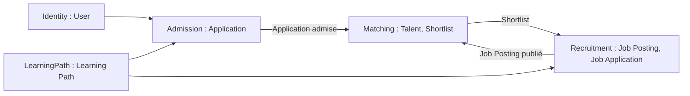
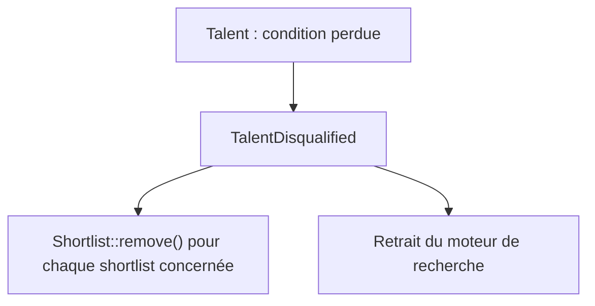
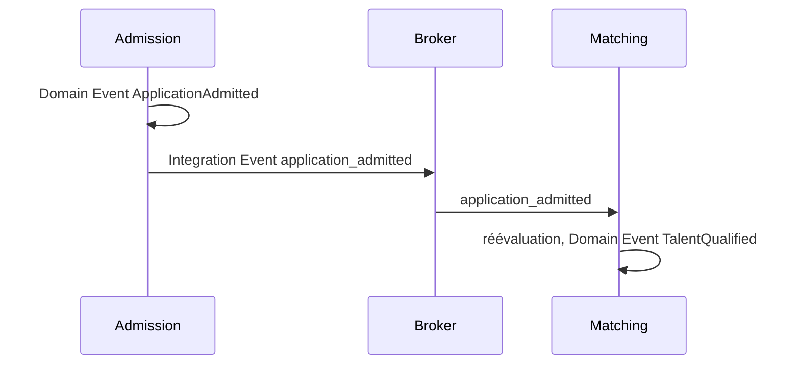

## Introduction

Le Domain Driven Design permet de concevoir une application en maintenant un lien fort entre le Produit et l'Engineering.

Toute application a un but précis répondant à un besoin identifié. L'objectif est de concevoir une application qui répond au besoin, tout en gardant en tête que c'est bien le besoin qui drive le design.

Côté Engineering, il existe toujours plusieurs façons de répondre à un besoin. Cependant, les échanges entre le Produit et l'Engineering sont d'autant plus complexes que le design est éloigné du besoin métier, même si celui-ci y répond.

L'utilisation du DDD permet de simplifier les échanges entre les équipes et de placer le métier au centre du design.

Dans cet article, nous allons voir comment définir et structurer le Domain Model d'une application permettant à des utilisateurs de suivre une formation en alternance. On part des besoins, et on fait apparaître chaque notion du DDD au moment où elle devient utile.

---

## Domaine & sous-domaines

Afin de répondre au besoin, l'application doit permettre de :

- créer un compte,
- lister des formations,
- candidater à une formation,
- créer des offres d'alternance en lien avec les formations proposées,
- identifier les offres en adéquation avec un profil,
- identifier les profils en adéquation avec une offre,
- postuler aux offres,
- recevoir des suggestions de profils.

Le **domaine** correspond au métier de l'application. Ici, le domaine principal est l'éducation à travers l'apprentissage : former des personnes et les amener à un contrat d'alternance.

Un domaine est trop large pour être modélisé d'un seul bloc. On le découpe en **sous-domaines**, en regroupant les besoins qui parlent du même sujet :

| Besoin | Sous-domaine |
|---|---|
| Créer un compte | Identity |
| Lister des formations | LearningPath |
| Candidater à une formation | Admission |
| Créer des offres d'alternance | Recruitment |
| Postuler aux offres | Recruitment |
| Identifier les offres pour un profil | Matching |
| Identifier les profils pour une offre | Matching |
| Recevoir des suggestions de profils | Matching |

Tous les sous-domaines n'ont pas la même valeur. Le DDD les classe en trois catégories :

| Type | Définition | Sous-domaines |
|---|---|---|
| **Core** | Ce qui différencie la plateforme. On y investit le plus d'effort de modélisation. | Matching |
| **Supporting** | Spécifique au métier, nécessaire, mais pas différenciant | LearningPath, Admission, Recruitment |
| **Generic** | Ce que toutes les applications ont. On réutilise une solution existante. | Identity |

Ce classement guide l'effort : un modèle riche et soigné pour le Matching, un CRUD simple ou un outil du marché pour la gestion des comptes.

---

## Ubiquitous Language

Avant de dessiner quoi que ce soit, il faut se mettre d'accord sur les mots. L'**Ubiquitous Language** est le vocabulaire partagé entre le Produit, le métier et l'Engineering. Il est utilisé partout : en réunion, dans les tickets, dans les tests et dans le code.

En relisant la liste des besoins, deux problèmes apparaissent.

**Le même mot désigne deux choses différentes.** "Candidater à une formation" et "postuler à une offre" sont deux candidatures, mais elles n'ont rien en commun : l'une est étudiée par une équipe d'admission, l'autre par une entreprise. Si on les appelle toutes les deux "candidature", les échanges deviennent ambigus très vite.

**Une même personne porte plusieurs noms.** Utilisateur, candidat, apprenant, profil, talent : selon l'étape, on ne parle pas de la même chose.

On fixe donc le vocabulaire :

| Terme | Définition |
|---|---|
| User | Personne qui possède un compte |
| Application | Candidature d'un user à une formation |
| Learning Path | Formation proposée sur la plateforme |
| Job Posting | Offre d'alternance publiée par une entreprise, liée à une ou plusieurs formations |
| Job Application | Candidature d'un talent à une offre |
| Talent | User dont l'Application est admise et qui peut être proposé sur des offres |
| Search Area | Zone géographique dans laquelle un talent recherche une alternance |
| Shortlist | Sélection de talents suggérés pour une offre |

Ce vocabulaire se retrouve tel quel dans le code. Si le Produit dit "le talent est disqualifié", le code contient `TalentDisqualified`, pas `UserStatusChanged`.

---

## Bounded Contexts

Le tableau précédent fonctionne parce que chaque mot a un sens précis. Mais ce sens n'est valable que dans un périmètre donné. Ce périmètre, c'est le **Bounded Context**.

Un Bounded Context est une frontière explicite dans la solution. À l'intérieur, un modèle et un langage sont cohérents. Ici, chaque sous-domaine donne un Bounded Context :



Une même personne existe dans plusieurs contextes, avec un modèle différent dans chacun :

- dans **Identity**, c'est un `User` : un email, un mot de passe, des rôles,
- dans **Admission**, c'est le porteur d'une `Application` : des étapes, un statut, une formation demandée,
- dans **Matching**, c'est un `Talent` : une formation obtenue, une date de démarrage souhaitée, des zones de recherche.

Ces modèles **partagent un identifiant**, pas une classe. `Talent` n'hérite pas de `User`. Chercher à faire un seul modèle "Personne" pour tous les contextes donne un objet énorme, que tout le monde modifie et que personne ne comprend.

À retenir : un **sous-domaine** découpe le problème, un **Bounded Context** découpe la solution. Ils coïncident souvent, mais ce sont deux notions distinctes.

---

## Domain Model

Le **Domain Model** est la représentation du métier à l'intérieur d'un Bounded Context. Ce n'est pas une classe, c'est un ensemble de concepts, de règles et de comportements, exprimés avec des briques : Entities, Value Objects, Aggregates.

On se concentre sur le contexte **Matching**, le Core Domain. Ses règles métier :

- un user devient **talent** lorsque son Application est admise sur une formation et qu'il a indiqué une date de démarrage souhaitée,
- il cesse d'être talent dès qu'une de ces conditions n'est plus remplie,
- une offre correspond à un talent si elle est liée à la formation du talent et si elle se situe dans l'une de ses zones de recherche,
- une shortlist ne contient que des talents.

Les exemples de code qui suivent s'inscrivent dans cette structure :

```
src/Matching/
├─ Domain/
│  ├─ Entity/          Talent, Shortlist, JobPosting
│  ├─ ValueObject/     TalentId, SearchArea, Location...
│  ├─ Event/           TalentQualified, TalentDisqualified...
│  ├─ Exception/       InvalidSearchArea...
│  └─ Gateway/         ShortlistGateway, TalentSearchGateway...
├─ Application/
│  └─ UseCase/         SuggestTalent
└─ Infrastructure/
   └─ Doctrine/        DoctrineShortlistGateway
```

### Entities

Une **Entity** est un objet défini par son **identité** et son **cycle de vie**, pas par la valeur de ses attributs.

Le talent est une Entity : il a une identité stable (`TalentId`), il devient talent, il évolue, il peut cesser de l'être. Deux talents avec la même formation et la même date de démarrage restent deux personnes différentes.

```php
namespace App\Matching\Domain\Entity;

use App\Matching\Domain\ValueObject\LearningPathId;
use App\Matching\Domain\ValueObject\SearchArea;
use App\Matching\Domain\ValueObject\TalentId;

final class Talent
{
    public function __construct(
        private readonly TalentId $id,
        private LearningPathId $learningPathId,
        private \DateTimeImmutable $wishedStartDate,
        /** @var list<SearchArea> */
        private array $searchAreas,
    ) {
    }

    public function id(): TalentId
    {
        return $this->id;
    }

    public function matches(JobPosting $posting): bool
    {
        if (!$posting->isLinkedTo($this->learningPathId)) {
            return false;
        }

        foreach ($this->searchAreas as $area) {
            if ($area->contains($posting->location())) {
                return true;
            }
        }

        return false;
    }
}
```

La règle de correspondance est portée par l'entité elle-même, pas par un service externe qui lirait ses getters. C'est la différence entre un modèle **riche** et un modèle **anémique**.

`JobPosting` est ici l'offre **vue par le Matching** : seulement ce dont le matching a besoin (formations liées, localisation). Ce n'est pas l'entité du contexte Recruitment, qui reste propriétaire de l'offre complète.

### Value Objects

Un **Value Object** est défini uniquement par ses valeurs. Il n'a pas d'identité, il est immuable et valide par construction. Deux VO avec les mêmes valeurs sont interchangeables.

Dans le contexte Matching :

- `TalentId`, `LearningPathId` : des identifiants typés plutôt que des `string`,
- `Location` : la position d'une offre (latitude, longitude),
- `SearchArea` : une zone de recherche d'un talent.

```php
namespace App\Matching\Domain\ValueObject;

use App\Matching\Domain\Exception\InvalidSearchArea;

final class SearchArea
{
    public function __construct(
        public readonly Location $southWest,
        public readonly Location $northEast,
    ) {
        if ($southWest->latitude > $northEast->latitude) {
            throw new InvalidSearchArea();
        }
    }

    public function contains(Location $location): bool
    {
        return $location->latitude >= $this->southWest->latitude
            && $location->latitude <= $this->northEast->latitude
            && $location->longitude >= $this->southWest->longitude
            && $location->longitude <= $this->northEast->longitude;
    }
}
```

Quand un talent change de zone de recherche, on ne modifie pas la `SearchArea` : on la remplace par une nouvelle. Une zone invalide ne peut pas exister, puisque le constructeur la refuse.

Les identifiants sont eux aussi des Value Objects. `TalentId`, `ShortlistId` ou `JobPostingId` ne sont que des attributs de leur aggregate, mais les typer plutôt que d'utiliser des `string` évite de les confondre. Avec des `string`, rien n'empêche ce genre d'erreur :

```php
// __construct(string $id, string $jobPostingId)
new Shortlist($jobPostingId, $shortlistId); // arguments inversés, aucune erreur
```

Avec des identifiants typés, cette ligne déclenche une `TypeError`. Le type indique aussi quel aggregate est référencé : une Shortlist contient une `list<TalentId>`, pas une `array<string>`. Enfin, le format de l'identifiant n'est validé qu'une fois, à la construction :

```php
namespace App\Matching\Domain\ValueObject;

use App\Matching\Domain\Exception\InvalidTalentId;

final class TalentId
{
    private const string UUID_PATTERN = '/^[0-9a-f]{8}-[0-9a-f]{4}-[0-9a-f]{4}-[0-9a-f]{4}-[0-9a-f]{12}$/i';

    private function __construct(
        public readonly string $value,
    ) {
    }

    public static function fromString(string $value): self
    {
        if (preg_match(self::UUID_PATTERN, $value) !== 1) {
            throw new InvalidTalentId($value);
        }

        return new self($value);
    }

    public function equals(self $other): bool
    {
        return $this->value === $other->value;
    }
}
```

Le bon réflexe : **privilégier les Value Objects**, et ne créer une Entity que lorsque l'identité a un vrai sens métier.

### Aggregate & Aggregate Root

Un **Aggregate** est un groupe d'objets (Entities et Value Objects) traité comme **une seule unité de cohérence**. L'**Aggregate Root** est l'entité qui sert de point d'entrée unique et qui garantit les règles du groupe.

La Shortlist en est un bon exemple. Elle regroupe les talents suggérés pour une offre, et porte une règle : un talent n'y figure qu'une seule fois.

```php
namespace App\Matching\Domain\Entity;

use App\Matching\Domain\ValueObject\JobPostingId;
use App\Matching\Domain\ValueObject\ShortlistId;
use App\Matching\Domain\ValueObject\TalentId;

final class Shortlist
{
    /** @var array<string, TalentId> */
    private array $talentIds = [];

    public function __construct(
        private readonly ShortlistId $id,
        private readonly JobPostingId $jobPostingId,
    ) {
    }

    public function add(TalentId $talentId): void
    {
        $this->talentIds[$talentId->value] = $talentId;
    }

    public function remove(TalentId $talentId): void
    {
        unset($this->talentIds[$talentId->value]);
    }
}
```

Les règles qui vont avec un aggregate :

1. **on ne passe que par la racine** : personne ne modifie la liste de talents directement,
2. **une transaction modifie un seul aggregate**,
3. **les aggregates se référencent par identifiant** : la Shortlist contient des `TalentId`, pas des objets `Talent`. Talent et Shortlist sont deux aggregates distincts,
4. **une gateway de persistance par Aggregate Root**,
5. **garder les aggregates petits**, dessinés autour des règles à protéger, pas autour des relations entre données.

Un aggregate peut se réduire à une seule entité : c'est le cas de `Talent`, qui est son propre Aggregate Root.

Dans cet article, les fichiers sont rangés par type de brique (`Entity/`, `ValueObject/`...) pour suivre le déroulé des sections. Sur un projet, on peut aussi les ranger **par aggregate** (`Domain/Talent/`, `Domain/Shortlist/`), chaque dossier regroupant la racine, ses Value Objects, ses événements et sa gateway : la frontière de cohérence devient alors visible directement dans la structure.

### Port & Adapter

Le Domain Model ne doit dépendre d'aucune technologie. La Shortlist ne sait pas si elle est stockée dans PostgreSQL ou ailleurs. Pour communiquer avec l'extérieur, le domaine définit des **ports** (des interfaces), implémentés en infrastructure par des **adapters**.

Le port, dans le domaine :

```php
namespace App\Matching\Domain\Gateway;

use App\Matching\Domain\Entity\Shortlist;
use App\Matching\Domain\ValueObject\ShortlistId;
use App\Matching\Domain\ValueObject\TalentId;

interface ShortlistGateway
{
    public function get(ShortlistId $id): Shortlist;

    /** @return list<Shortlist> */
    public function findContaining(TalentId $talentId): array;

    public function save(Shortlist $shortlist): void;
}
```

L'adapter, en infrastructure :

```php
namespace App\Matching\Infrastructure\Doctrine;

use App\Matching\Domain\Gateway\ShortlistGateway;

final class DoctrineShortlistGateway implements ShortlistGateway
{
    // ...
}
```

Le **use case** fait le lien : il charge l'aggregate via le port, appelle la méthode métier, puis sauvegarde.

```php
namespace App\Matching\Application\UseCase\SuggestTalent;

use App\Matching\Domain\Gateway\ShortlistGateway;

final class SuggestTalentHandler
{
    public function __construct(
        private ShortlistGateway $shortlists,
    ) {
    }

    public function __invoke(SuggestTalent $command): void
    {
        $shortlist = $this->shortlists->get($command->shortlistId);
        $shortlist->add($command->talentId);
        $this->shortlists->save($shortlist);
    }
}
```

Les rôles sont bien séparés :

| Élément | Rôle | Couche |
|---|---|---|
| `Shortlist` | Applique les règles métier | Domaine |
| `ShortlistGateway` | Définit le contrat | Domaine |
| `DoctrineShortlistGateway` | Implémente le contrat | Infrastructure |
| `SuggestTalentHandler` | Orchestre | Application |

On rencontre aussi des ports qui ne servent pas à la persistance d'un aggregate : un `TalentSearchGateway` pour alimenter un moteur de recherche, ou un `TalentProfileGateway` pour lire des données venant d'autres contextes. Son implémentation joue alors le rôle d'**Anti-Corruption Layer** : elle traduit le modèle des autres contextes vers celui du Matching.

---

## Domain Events

Un **Domain Event** représente un fait métier qui s'est produit dans le contexte. Il est nommé au passé, avec les mots de l'Ubiquitous Language, et il est immuable.

Dans le Matching :

- `TalentQualified` : un user remplit toutes les conditions, il devient talent,
- `TalentDisqualified` : il en a perdu une,
- `TalentShortlisted` : un talent a été ajouté à une shortlist.

```php
namespace App\Matching\Domain\Event;

use App\Matching\Domain\ValueObject\TalentId;

final class TalentDisqualified
{
    public function __construct(
        public readonly TalentId $talentId,
        public readonly \DateTimeImmutable $occurredAt,
    ) {
    }
}
```

Les Domain Events permettent de déclencher des réactions sans coupler les aggregates. Quand un talent est disqualifié, il doit être retiré de toutes les shortlists. Plutôt que de modifier le talent et toutes les shortlists dans une seule transaction, on réagit à l'événement :



Chaque shortlist est mise à jour dans sa propre transaction. La cohérence entre le talent et les shortlists est **éventuelle** : pendant un court instant, une shortlist peut encore contenir un talent disqualifié. Les handlers doivent être **idempotents** : retirer un talent déjà retiré ne doit pas échouer.

Un Domain Event reste interne au Bounded Context. Il peut contenir des types riches du modèle (`TalentId`) et évoluer librement avec lui.

---

## Integration Events

Un **Integration Event** est un événement publié **vers les autres Bounded Contexts**. Il passe généralement par un broker (RabbitMQ, SQS, Kafka...) et il est consommé de façon asynchrone.

Le contexte Matching a besoin de savoir quand une Application est admise. Mais l'Application appartient au contexte Admission. Le Matching ne va donc pas lire la base de l'Admission. C'est l'Admission qui publie un Integration Event :

```json
{
  "type": "admission.application_admitted",
  "version": 1,
  "applicationId": "0b6e...",
  "userId": "4f1c...",
  "learningPathId": "a93d...",
  "admittedAt": "2026-10-20T09:30:00+02:00"
}
```

Le Matching le consomme, le traduit dans son propre modèle et décide si le user devient talent. Si oui, il enregistre un Domain Event `TalentQualified`.



Les différences avec un Domain Event :

| | Domain Event | Integration Event |
|---|---|---|
| Portée | Interne au contexte | Entre contextes |
| Contenu | Types du modèle | Données primitives, sérialisées |
| Évolution | Libre | Contrat public, versionné |
| Transport | En mémoire | Broker, asynchrone |
| Livraison | Une fois | Au moins une fois : consommateurs idempotents |

Tous les Domain Events ne deviennent pas des Integration Events. On ne publie que ce qui a du sens pour les autres contextes, et on n'expose jamais son modèle interne. Pour garantir que l'événement est publié si et seulement si l'état a été sauvegardé, on utilise généralement un **transactional outbox**.

---

## Conclusion

En partant de la liste des besoins, on a construit le Domain Model étape par étape :

1. **les besoins** se regroupent en **sous-domaines**, classés Core, Supporting ou Generic pour savoir où investir,
2. **l'Ubiquitous Language** lève les ambiguïtés (deux candidatures, cinq noms pour une même personne),
3. **les Bounded Contexts** donnent à chaque mot un périmètre où il a un sens précis,
4. dans le contexte Matching, le **Domain Model** s'exprime avec des **Entities** (Talent), des **Value Objects** (SearchArea, Location), des **Aggregates** (Shortlist),
5. les **ports et adapters** isolent ce modèle de la technique,
6. les **Domain Events** propagent les changements à l'intérieur du contexte,
7. les **Integration Events** font communiquer les contextes sans les coupler.

À chaque étape, la question reste la même : est-ce que le Produit reconnaît son métier en lisant le code ? Si la réponse est oui, le design répond au besoin.
