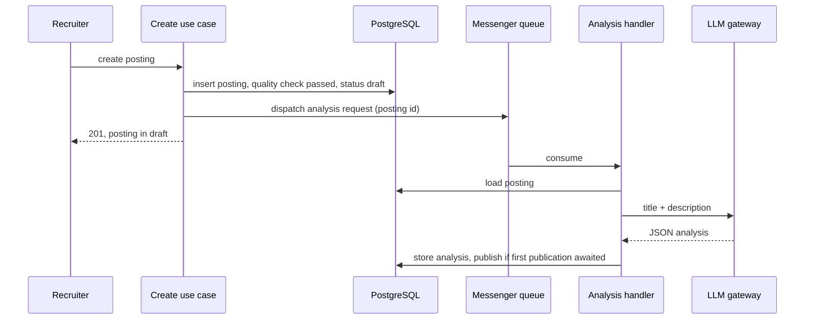

Recruiters create job postings. A downstream data pipeline imports the **published** ones and needed structured skills on each: hard skills and soft skills, extracted by an LLM from the title and the description.

Two constraints shaped the design:

- The pipeline imports at publication. A posting published without skills gets imported without skills.
- An LLM call is slow and fails in ways a database query does not. It does not belong in the HTTP request that creates the posting.

So the analysis has to run asynchronously, and the first publication has to wait for it.

---

## The naive options

**Call the LLM in the request.** The creation request already ran one synchronous LLM call: an automated quality check that decides whether the posting can go live. During testing, that call alone was enough to hit the gateway timeout when the LLM backend slowed down. Adding a second call in the same request doubles the exposure.

**Publish, then enrich.** Cheap to build, but the import happens at publication. The skills arrive after the pipeline has already read the posting.

**Block publication until the analysis succeeds.** Correct order, but an LLM outage would freeze every new posting. Skills are an enrichment, not a reason to keep a recruiter's posting offline.

The design I shipped takes the middle path: hold the first publication for the analysis, never for a failed analysis.

---

## The flow



The request does the cheap, deterministic work and returns. The worker does the slow work and decides on publication.

---

## State: who is waiting for what

The entity carries two questions as methods, so neither the use cases nor the handler re-implement the rules:

```php
public function awaitsJobAnalysis(): bool
{
    return !$this->isClaimed()
        && $this->jobAnalyzedAt === null
        && $this->hasNeverBeenPublished();
}

public function awaitsPublication(): bool
{
    return $this->publicationStatus === PublicationStatus::DRAFT
        && $this->hasPassedQualityCheck()
        && $this->hasNeverBeenPublished()
        && !$this->organization->isFlagged();
}

public function publishOnceAnalyzed(): self
{
    if ($this->awaitsJobAnalysis()) {
        return $this;
    }

    return $this->publish();
}
```

The publication paths that used to call `publish()` now call `publishOnceAnalyzed()`. A first publication becomes a no-op while the analysis is missing: the posting stays in draft with a passed quality check, which is exactly what `awaitsPublication()` detects later.

The exclusions matter as much as the rule:

- **Claimed postings** (imported from an external source, then claimed by a recruiter) are already known to the pipeline. They publish immediately and are not analyzed.
- **Postings published once** are never held again. Editing a live posting must not take it offline.

Other consumers of "is this posting live?" had to learn the new state. The talent shortlist generation, for example, used to skip unpublished postings. A posting that awaits publication is not unpublished, it is early, so that job now postpones itself instead of giving up.

---

## The handler

The handler is a plain Messenger handler on a dedicated transport:

```php
#[AsMessageHandler]
final class ExtractJobPostingSkills
{
    public function __invoke(ExtractJobPostingSkillsRequest $request): void
    {
        $jobPosting = $this->entityGateway->findById(JobPosting::class, $request->jobPostingId);

        $response = $this->llmClient->executePrompt(
            promptId: self::PROMPT_ID,
            message: Json::serialize([
                'title' => $jobPosting->title,
                'description' => $jobPosting->getDescription(),
            ]),
        );

        $jobAnalysis = $this->toJobAnalysis($response);

        if ($jobAnalysis === null) {
            $this->logger->error('Invalid skills extraction response', ['jobPostingId' => $jobPosting->getId()]);
            $this->metrics->increment('job_posting.skills_extraction.error', ['reason' => 'invalid_response']);
        } else {
            $jobPosting->recordJobAnalysis($jobAnalysis);
            $this->metrics->increment('job_posting.skills_extraction.success');
        }

        $isPublished = $this->publishIfAwaited($jobPosting);
        $this->entityGateway->update($jobPosting);

        if ($isPublished) {
            $this->sendPublicationEvent($jobPosting);
        }
    }
}
```

Two failure modes, two different answers:

- **The LLM call fails** (timeout, 5xx). The exception is rethrown. The transport retries with backoff, and only gives up into a failure transport after the last attempt. This is the case where waiting helps. See [exponential backoff]() for the reasoning behind growing delays.
- **The LLM answers, but not with a JSON object.** Retrying the same prompt on the same text will not fix it. The handler logs it, counts it, keeps any previous analysis, and **publishes anyway**. The recruiter's posting does not pay for a bad completion.

The publication event is sent by the handler when it publishes, because that is now where the first publication happens. The create use case only sends it for postings that were published synchronously.

The transport configuration is ordinary Messenger:

```yaml
framework:
  messenger:
    transports:
      llm:
        dsn: "%env(MESSENGER_TRANSPORT_DSN)%"
        failure_transport: failed_llm
        retry_strategy:
          max_retries: 4
          delay: 60000
          multiplier: 3
    routing:
      'App\Message\LlmMessage': llm
```

Routing by a marker interface keeps the use cases unaware of transports: any message implementing it goes to the LLM queue.

---

## Storage: keep the full answer, index what you query

The handler stores the **whole** JSON response in a JSONB column. The prompt will evolve, and the data team should not wait for a migration each time a field is added.

The two fields everyone queries are projected into generated columns:

```sql
ALTER TABLE job_posting
    ADD COLUMN job_analysis    JSONB DEFAULT NULL,
    ADD COLUMN job_analyzed_at TIMESTAMP(0) WITHOUT TIME ZONE DEFAULT NULL,
    ADD COLUMN hard_skills JSONB GENERATED ALWAYS AS (
        CASE WHEN jsonb_typeof(job_analysis->'hard_skills') = 'array'
            THEN JSONB_PATH_QUERY_ARRAY(job_analysis, '$.hard_skills[*]')
            ELSE '[]'::jsonb
        END
    ) STORED NOT NULL,
    ADD COLUMN soft_skills JSONB GENERATED ALWAYS AS (
        CASE WHEN jsonb_typeof(job_analysis->'soft_skills') = 'array'
            THEN JSONB_PATH_QUERY_ARRAY(job_analysis, '$.soft_skills[*]')
            ELSE '[]'::jsonb
        END
    ) STORED NOT NULL;
```

The `CASE` is there because the input is an LLM answer. If a field comes back as a string or is missing, the column is an empty array instead of an error or a `NULL` that every consumer has to handle. The same technique, applied to a search replica, is in [dual-write search with generated columns]().

On the Doctrine side the columns are mapped read-only (`insertable="false"`, `updatable="false"`, `generated="ALWAYS"`), so the ORM refreshes them after a write and never tries to set them.

---

## When to re-analyze

Creation always requests an analysis, except for claimed postings. Edits request one only when the title or the description changed:

```php
$previousTitle = $jobPosting->title;
$previousDescription = $jobPosting->getDescription();

$this->updateJobPosting($jobPosting, $request);

if ($jobPosting->title !== $previousTitle || $jobPosting->getDescription() !== $previousDescription) {
    $this->bus->dispatch(new ExtractJobPostingSkillsRequest($jobPosting->getId()));
}
```

Changing the salary range or the contract type does not change the skills, and should not cost an LLM call.

I looked at moving this to a declarative attribute that dispatches a message after the use case returns. The tooling existed, but it had no way to express a condition, and it logged dispatch errors instead of propagating them. For a message that gates publication, a silent dispatch failure is the worst outcome, so the dispatch stayed explicit.

---

## What testing taught me

**A timeout that was not mine.** The first end-to-end test on a shared environment returned a gateway timeout on creation. The new code was the obvious suspect. The database said otherwise: on the failing postings, the quality check request timestamp had been rewritten exactly 60 seconds after creation, the signature of the existing synchronous quality check failing and resetting. Postings created on the previous code in the same window had the same signature. The LLM backend was slow that afternoon. Timestamps written by the application were a better trace than any dashboard, because that environment had none for the backend.

**A shared queue across versions drops messages.** Preview environments shared a database, and therefore a Doctrine Messenger table, with an environment whose workers ran the previous code. Those workers consumed the new message class, could not decode it, and removed it. The postings stayed in draft, forever, with nothing in the failure transport. The same thing can happen during a rolling deploy when a new web pod dispatches before the workers roll. Async gating creates a liveness dependency: if the message is lost, the posting is stuck.

**Reviews push towards an outbox.** An automated review flagged that the message is dispatched after the posting is flushed: a failed dispatch would leave a passed draft with no analysis request. With a Doctrine transport, dispatching is an insert into the same database that just committed, so that window is narrow. More importantly, an outbox would not have saved the postings lost to a consumer on the wrong version. Both failures have the same symptom, a draft that passed its quality check and has no analysis after a while, and the same cure.

---

## Next decision

The cure is a reconciliation job: find postings that await publication with no analysis after N minutes, then re-dispatch the analysis or publish them. It covers a lost dispatch, a lost message, and a message parked in the failure transport, with one query on state the entity already exposes.

I have not built it yet. The failure needs a version mismatch or a database hiccup at the wrong millisecond, and the query that detects it is the same one I would use to watch for it. If it shows up in practice, the job is small, and the state machine above is what makes it small.
